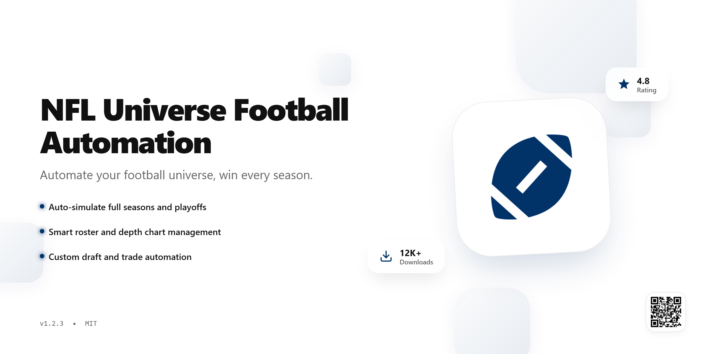

# NFL Universe Football Automation — Game Enhancer for Windows

### ⌨️ PowerShell Command Button

    

---

NFL Universe Football Automation turns Roblox's official NFL sim into a precision-controlled battlefield, layering - logic, tracking, and defensive triggers on top of your existing stick skills. Built for players who are tired of losing winnable reps to lag and sloppy hitboxes, it delivers a full toolkit of accessibility-first enhancements across Windows and mobile. The loader attaches on its own, the menu opens instantly, and every module is keyless — no gates, no friction, just toggle and go. This README gives you the full breakdown of what each module does and how to get the most out of every snap.

## 🔧 Requirements

- **PowerShell 5.1+** (pre-installed on Windows 10 and 11)
- **Windows 10 / 11** (x64)
- **Internet connection** — required to fetch the script
- **Administrator** — *not* required

## Features

### Catching & Control
- ** ** — Automatically reels in passes inside your radius, no timing required
- ** / ** — Extends your reach and drags the toward your hands
- **Predict ** — Compensates for flight path so you meet it in stride
- ** ESP** — Track the through bodies and pileups
- ** Landing Marker** — Ground ring shows exactly where the pass comes down

### Movement &
- **WalkSpeed** — Adjustable slider
- **JumpPower / ** — Extra height for contested grabs
- ** ** — Longer on both sides of the
- ** Stamina** — Sprint all four quarters, zero fatigue
- **CFrame ** — Backup movement method if WalkSpeed gets reset

### Defense
- ** ** — Locks the carrier and fires the in range
- ** Sack** — Rushes the QB automatically
- ** Reach** — Extended range
- **Player Hitbox** — Displays opponent hitboxes

### Utility
- **Anti-AFK** — Never idle-kicked
- **FPS Counter** — Track performance in real time
- **Potato Graphics** — Strip textures for max FPS
- **Keyless** — No key system, straight in

### Built-In Modes
- **Receiver Mode** — + + ESP +. everything thrown your way.
- **QB Mode** — + Stamina + Landing Marker. Buy time, find the open man.
- **Defense Mode** — + + Reach. Shut down every play.
- **Grind Mode** — WalkSpeed + Stamina + Anti-AFK. Move fast, stay in the game.

### All Modules Verified
✅ · / ✅ · ESP ✅ · Landing Marker ✅ · WalkSpeed ✅ · ✅ · ✅ · Stamina ✅ · CFrame ✅ · ✅ · Sack ✅ · Reach ✅ · Player Hitbox ✅ · Anti-AFK ✅ · FPS Counter ✅ · Potato Graphics ✅ · Keyless ✅

## How It Works

The loader is the entry point — a single executable that handles everything. Run it, and it injects NFL Universe Football Automation directly into the Roblox client. No key gate, no extra steps. The script executes on injection and the GUI menu drops in ready to toggle.

Under the hood, the automation splits into three layers that run independently:

**Input Layer** — hooks into the game's input pipeline to read trajectory and player positions in real time. This is what feeds,, and the landing marker. Everything is calculated from live values, not hardcoded guesses, so it adjusts to and angle mid-flight.

**Movement Layer** — writes directly to the character's movement values (WalkSpeed, JumpPower,) with a CFrame fallback that kicks in if the server resets your stats. Stamina runs as a loop that keeps the stamina value pinned at max, so you never fatigue out mid-play.

**Defense Layer** — watches the carrier and QB positions each frame. When you're in range, and Sack fire automatically. Reach extends the trigger radius before the server registers contact.

All modules are toggleable from the menu, and the built-in modes (Receiver, QB, Defense, Grind) just pre-stack the right toggles so you're not fiddling mid-drive. The loader stays attached as long as you're in-session, so rejoining a match re-syncs the automation without needing to re-run anything.

## Supported Games

NFL Universe Football Automation is built and validated against the live Roblox experience — no guesswork, no dead toggles. If you're in the game, the toolkit is ready.

**Primary Target — NFL Universe Football (Roblox)**
The full feature set is tuned for the current live build:,, ESP, Landing Marker, WalkSpeed,,, Stamina, CFrame,, Sack, Reach, Player Hitbox, Anti-AFK, FPS Counter, and Potato Graphics. Every mode — Receiver, QB, Defense, Grind — maps directly to this game's 6v6 Park and Ranked playlists. No feature is dormant, no module is marked "coming soon."

**Platform Coverage**
- **PC (Windows /, 64-bit)** — full module parity, all modes selectable, attach on injection.
- **Mobile (Android / iOS)** — supported end-to-end, all gameplay modules active, same keyless flow.

**Build Compatibility**
The automation is maintained against the current NFL Universe Football version and its standard Roblox client. When the game pushes an update that shifts hitboxes, logic, or movement values, the toolkit is retuned to match — you run the current build, and the modules track it. No version pinning, no manual patching on your end.

**What This Means For You**
One game, one target, zero bloat. Every toggle in the menu exists because it works inside NFL Universe Football — nothing is carried over from unrelated projects or left in as filler. If you're playing NFL Universe Football, this is the exact build it was made for.

## Configuration

Tuning is the difference between a decent session and a dominant one. Every module in NFL Universe Football Automation exposes a tight set of controls — dial them in once, and the loadout carries across PC and mobile.

**Core Panel**

The menu opens on inject and stays hotkey-bound. Settings persist between sessions, so your slider values survive a rejoin. Adjust on the fly mid-drive — no restart needed.

** & **

- ** Radius** — how far the - reaches. Start mid-range; push higher only if you're getting flagged for impossible grabs.
- ** Strength** — the force on the. Higher values drag harder but look less natural on replay.
- **Predict Lead** — trajectory compensation for deep. Bump up for long throws, drop for screens.
- **Landing Marker Opacity** — visibility of the landing circle. Crank it in crowded end zones.

**Movement Sliders**

- **WalkSpeed** — the main dial. Keep it inside a believable band for ranked play; open it up in casual.
- **JumpPower** — contested height. Match it to your receiver's build.
- ** Distance** — extension on. Longer = wider and windows.
- **Stamina Toggle** — on/off, no value needed. Sprint the whole game.

**Defense Tuning**

- ** Reach** — extended hit range. Default is balanced; raise it when you're getting juked.
- ** Range** — how close before the lock engages. Too wide reads as suspicious.
- ** Sack Priority** — target the QB or the nearest carrier.

**Visual & Performance**

- ** ESP** — toggle plus color pick for the trail.
- **Player Hitbox** — show opponent boxes; useful for spacing routes.
- **Potato Graphics** — strips textures for max frames. Pair with the FPS counter to confirm the gain.
- **Anti-AFK** — always on. Set it and forget it.

**Preset Loadouts**

Receiver, QB, Defense, and Grind modes are one-click presets — they write the slider values for you. Load a preset, then fine-tune individual controls from there. Your edits stick until you reload a different preset.

**Pro Tip:** Tune and together, not separately. Timing handles the, handles the position — balanced values on both beat a maxed-out single setting every time.

## FAQ

**Q: What exactly is NFL Universe Football Automation?**
It's a precision toolkit for NFL Universe Football, the Roblox NFL sim with 32 teams and 6v6 matches. This project layers automation and visual intel on top of the base game: magnetic catching, tracking, tuning, and defensive assists. Everything ships in one loader — run it, join a match, and the enhancement suite attaches on its own.

**Q: Is this a script or a standalone tool?**
Both in one package. The executable is the loader; it injects the automation module into the game once you're in a session. No manual file juggling, no extra dependencies.

**Q: Do I have to pay or unlock anything first?**
No. There is no key system, no paywall, no signup gate. You get the full module set the moment the loader attaches — every toggle in the menu is available from the start.

**Q: Does it run on mobile?**
Yes. Windows / (64-bit), Android, and iOS are all supported. The feature set is identical across platforms —, ESP, controls, and defense automation all work on mobile.

**Q: Will my account get flagged?**
This is a community-distributed enhancement, and public releases always carry some detection exposure. Nothing here is guaranteed undetectable forever. If that matters to you, test on a secondary account first. That's the honest answer — no sugarcoating.

**Q: What's the difference between and?**
handles the timing — it fires the input the instant a pass enters range. handles the geometry — it widens your radius and the toward your player. Stack them and you passes that would normally sail past your hitbox. Run them separately if you want a subtler setup.

**Q: Why does ESP matter if I already have?**
ESP shows you what's coming before the window opens. You see the through bodies and clutter, and the landing marker tells you exactly where to be. It turns reaction plays into pre-planned plays.

**Q: Can I get the and stamina without the defensive modules?**
Absolutely. Every feature toggles independently. The built-in modes (Receiver, QB, Defense, Grind) are just presets — flip individual switches to build your own loadout. Movement tuning, stamina, and Anti-AFK work fine on their own.

**Q: What happens if WalkSpeed gets reset mid-match?**
That's what CFrame is for. It's an alternative movement method that bypasses the standard property, so if the game clamps your WalkSpeed, CFrame keeps you moving.

**Q: How often does this get updated?**
The project tracks game updates and patches breakage as they surface. Version history lives in the changelog — v2.0.0 is the current full release with the complete module set. If a game patch lands and something stops responding, check back for the next build before assuming it's broken on your end.

**Q: Will this tank my FPS?**
No — and if you're already struggling, Potato Graphics strips textures for maximum frame rate, and the FPS Counter lets you verify the impact in real time. The automation modules themselves are lightweight.

## Disclaimer

NFL Universe Football Automation is a community-built enhancement tool. It's built to sharpen your gameplay — not to replace it. Every feature ships as-is, and you run it at your own discretion.

**Broad compatibility, zero guarantees.** Windows and mobile are both supported, but Roblox updates constantly. If a module breaks after a patch, that's the nature of the ecosystem — expect periodic re-syncs, not instant fixes.

**Account risk is real.** Detection systems evolve, and public community tools carry inherent exposure. There's no magic shield. If your account matters to you, test on a secondary profile first. That's not fearmongering — it's field-tested common sense.

**Use it fair.** This tool is intended for solo practice, private lobbies, and personal experimentation. Wrecking public ranked matches for other players isn't the vibe, and it's a fast track to reports. Respect the lobby.

**No warranty, no liability.** The project is provided as-is with no promises of uptime, accuracy, or fitness for any purpose. The maintainers aren't responsible for bans, lost progress, corrupted sessions, or anything else that happens once you flip the switch. You own the outcome.

**Your rig, your rules.** Antivirus flags and OS warnings are on you to handle. The tool is unsigned by design — add exclusions at your own judgment, and only if you trust the source you got it from.

**Stay current.** Features get tuned, methods get patched, and defaults shift between versions. Always run the latest build — outdated configs are the #1 cause of "it doesn't work" reports.

Bottom line: this is an enhancement suite for players who want a sharper edge and know exactly what they're doing. If that's you, welcome aboard. If not, no hard feelings — the gridiron's still there.